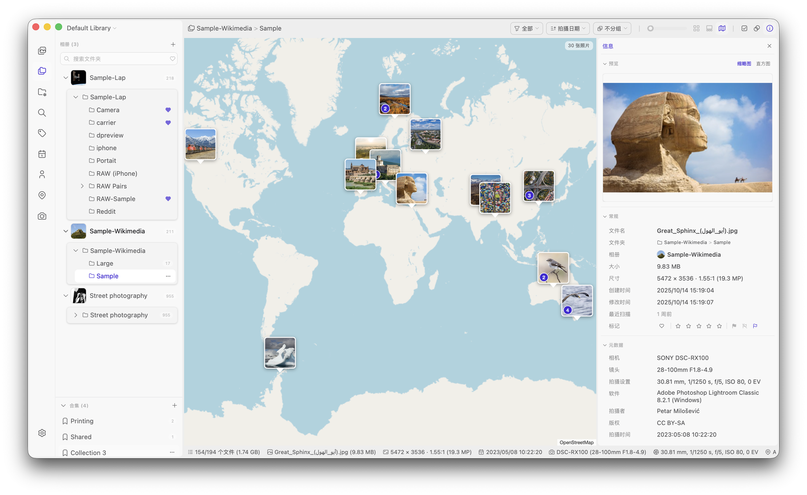

<div align="center">
  
  <h1>Lap Personal Edition</h1>
  <h3>A Windows-only, large-library fork of <a href="https://github.com/julyx10/lap">Lap</a> by julyx10.</h3>
  <p>
    <a href="https://github.com/SoloDevTH/lap-personal/releases"></a>
    <a href="LICENSE"></a>
  </p>
</div>

> [!NOTE]
> This is an unofficial, modified version of **[Lap](https://github.com/julyx10/lap)**, created by **julyx10**.
> All credit for the original application goes to julyx10 and the Lap contributors.
> Please report problems with this edition here, not to the upstream project.

## About this edition

Lap Personal Edition is based on Lap 0.3.2. It is tuned for very large libraries (tested with about 545,000 photos) on Windows.
Versions are labelled `0.3.2-personal.N` so they are easy to tell apart from official Lap releases.

### Changes from upstream Lap

**Windows only**
- macOS and Linux code, builds and CI were removed.

**Security and stability**
- Removed the local video HTTP server.
- Added a Content Security Policy.
- Fixed panics in URL decoding and in image decoders, which previously crashed the app in release builds.
- Escaped `LIKE` wildcards in searches.
- Validated library ids before using them in cache paths.
- A drive that is not connected is no longer treated as "file deleted".

**Deleting**
- Files move to the Recycle Bin in batches on several threads.
- A progress bar is shown, and the dialog always closes when deletion finishes.
- Deleted photos disappear from the grid right away, without reloading the page.
- Deleting files that are already gone no longer reports an error.

**Speed with large libraries**
- Selecting many photos no longer freezes the window.
- Thumbnails are generated in a newest-first queue, and cached thumbnails are checked in parallel.
- Folder sync skips files that have not changed.
- Duplicate scan only hashes files with the same size and dimensions, and reports progress smoothly.
- Removing an album deletes its rows in small batches, so the app stays responsive.
- Scan progress no longer gets stuck near 100% when some files fail.

**CPU use**
- Scanning, thumbnails, duplicate/similar search and AI indexing run at below-normal priority.
- They are limited to about half of the CPU, so the PC stays usable while Lap works.

The updater is disabled in this edition; download new versions from the [Releases](https://github.com/SoloDevTH/lap-personal/releases) page.

---

*The rest of this README is from upstream Lap.*

English | [Deutsch](i18n/README.de.md) | [Français](i18n/README.fr.md) | [Español](i18n/README.es.md) | [Português](i18n/README.pt.md) | [Русский](i18n/README.ru.md) | [简体中文](i18n/README.zh-CN.md) | [日本語](i18n/README.ja.md) | [한국어](i18n/README.ko.md)

Lap is an open-source, local-first photo manager for browsing family albums, finding old photos quickly, and managing large personal media libraries offline.
It is a privacy-focused alternative to cloud photo services: no forced upload, local AI search, folder-first workflow, and free to use.

- Website: [https://julyx10.github.io/lap/](https://julyx10.github.io/lap/)
- Demo: [https://youtu.be/RbKqNKhbVUs](https://youtu.be/RbKqNKhbVUs)
- Privacy: [PRIVACY.md](PRIVACY.md)

## Download Lap

For this edition, open the [latest release page](https://github.com/SoloDevTH/lap-personal/releases/latest) and download `Lap_<version>_x64_en-US.msi`.
For official Lap, use the [upstream releases](https://github.com/julyx10/lap/releases/latest).

| Platform | Package | Note |
| :-- | :-- | :-- |
| **Windows 10/11 (x64)** | `_x64_en-US.msi` | Unsigned. If SmartScreen blocks the download, click **Keep anyway** |

This edition uses the same app id as official Lap, so installing it replaces official Lap and keeps your existing library.

## Screenshots

<p align="center">
  
  
</p>

## Why Lap

- **Local-first by design**: your photos stay on your own disk, with no required cloud account or upload.
- **No library lock-in**: work directly with your existing folders instead of importing everything into a closed database.
- **Private AI tools**: search, similarity, smart tags, and face features run locally on your machine.
- **Built for large collections**: optimized for smooth browsing and organization across libraries with 100k+ files.
- **Open source and free**: no subscription, no forced ecosystem, and code you can inspect.

## Features

- **Flexible library browsing** with timeline, folder, location, camera, lens, tag, favorite, rating, subject, and face filters.
- **Smart Albums** save rule-based views with custom grouping, sorting, ordering.
- **Collections**: Organize files into flexible collections without moving or duplicating the originals.
- **Local AI search** for text prompts, visual similarity, subjects, face clustering, and optional multilingual search in 50+ languages.
- **Apple Live Photos** recognize paired HEIC/MOV Live Photos, play them in the viewer, and keep linked MOV and AAE sidecars together during rename, move, copy, and delete operations.
- **RAW + JPEG/HEIC pairs** optionally group a RAW file and its same-named JPEG or HEIC companion in the same folder as one item. The originals remain separate files, while rename, move, copy, paste, and delete operations keep the pair together.
- **Folder-first workflow** with multiple libraries, drag-and-drop import, copy-paste import, filesystem sync, and safe move/copy/delete operations.
- **Culling and comparison tools** including a four-pane image comparison viewer.
- **Cleanup tools** to find duplicates and batch move unwanted files to trash.
- **Built-in editing** for crop, rotate, flip, resize, and basic image adjustments.
- **Broad format support** for 60+ photo, RAW, and video formats.

## Metadata, Collections, and Moving Files

Lap is folder-first, but not every piece of information shown in Lap is embedded in the original file. This distinction matters when you also manage the same folders in Finder, Explorer, or another photo app.

### What stays with the file

- Your original photos and videos always remain ordinary files in their existing folders.
- File metadata already embedded in a file, such as EXIF capture date, camera, lens, GPS, and orientation, is read from that file when Lap indexes it.
- Saving a built-in image edit writes the resulting image to the selected destination.
- When you rename, move, copy, or delete files **in Lap**, Lap updates its local catalog at the same time. It also keeps supported grouped assets, such as Apple Live Photo components, AAE sidecars, and enabled RAW + JPEG/HEIC pairs, together.

### What is stored locally by Lap

The following are Lap library data. They are stored in Lap's local database or library configuration, not written into EXIF, IPTC, or XMP sidecars:

- Collections, Tags, Comments, Favorites, Ratings, and Culling states (including Picks and Rejects)
- Smart Albums and their rules, grouping, sorting, and ordering
- AI search data, face data, thumbnails, and other index/cache data

This data does not travel with a file when it is copied, exported, or moved outside Lap, and it is not available automatically to other applications.

### Working with files outside Lap

Lap can rescan folders and detect many filesystem changes. But changes made outside Lap—such as renaming, moving, replacing, or copying files—can disrupt organization that is stored only in Lap.

For the most reliable results, rename and move files in Lap whenever you rely on Collections, Tags, Comments, Favorites, Ratings, or culling states. If you also manage files outside Lap, back up Lap's database and configuration together with your photos. You can manage the database location and create a backup in **Settings → Storage**.

Deleting Lap's database or configuration removes this local organization and index data, but does not delete your original media files.

## Uninstall Lap

Lap works directly with your existing photo folders. Uninstalling Lap, or deleting its database and cache files, does **not** delete your original photos.

The standard uninstall steps remove the application. To remove Lap completely, quit Lap first, uninstall the application, then delete its local database, thumbnail cache, and configuration files.

Open **Settings > Apps > Installed apps**, find **Lap**, and select **Uninstall**.

Then open PowerShell and remove all Lap database, cache, and configuration files:

```powershell
Remove-Item -Recurse -Force -ErrorAction SilentlyContinue "$env:LOCALAPPDATA\com.julyx10.lap"
Remove-Item -Recurse -Force -ErrorAction SilentlyContinue "$env:APPDATA\com.julyx10.lap"
```

If you selected a custom database storage directory in Lap settings, delete that directory separately after confirming that it contains only Lap database files.

## Build from Source

Requirements: Windows 10/11, Visual Studio 2022 Build Tools (C++ workload), CMake, Node.js 20+, pnpm, Rust stable (MSVC toolchain).

```powershell
git clone --recursive https://github.com/SoloDevTH/lap-personal.git
cd lap-personal
git submodule update --init --recursive
cargo install tauri-cli --version "^2.0.0" --locked
.\scripts\download_models.ps1
.\scripts\download_ffmpeg_sidecar.ps1
cd src-vite; pnpm install; cd ..
cargo tauri dev
```

Build the Personal Edition installer:

```powershell
cargo tauri build --bundles msi --config src-tauri/tauri.personal.conf.json
```

If the C++ compiler runs out of memory, limit parallel jobs first: `$env:CARGO_BUILD_JOBS=2; $env:CMAKE_BUILD_PARALLEL_LEVEL=1`.

## Supported Formats

Lap supports 60+ photo, RAW, and video formats.

| Type | Formats |
| :--- | :--- |
| Images | JPG/JPEG/JFIF, PNG, GIF, BMP, TIFF, WebP, HEIC/HEIF/HIF, AVIF, JXL, PSD, EXR, HDR/RGBE, TGA, JPEG 2000 (JP2/J2K/J2C/JPC/JPF/JPX), DDS, DPX, QOI |
| RAW photos | CR2, CR3, CRW, NEF, NRW, ARW, SRF, SR2, RAF, RW2, ORF, PEF, DNG, SRW, RWL, MRW, 3FR, MOS, DCR, KDC, ERF, MEF, RAW, MDC |
| Videos | MP4, MOV, M4V, MKV, AVI, FLV, TS/M2TS, WMV, WebM, 3GP/3G2, F4V, VOB, MPG/MPEG, ASF, DIVX and more. H.264 MP4 plays natively; other formats are converted automatically for playback. |

## Architecture

- Core: Tauri + Rust
- Frontend: Vue + Vite + Tailwind CSS
- Data: SQLite

### Key Libraries

| Library | Purpose |
| :-- | :-- |
| [LibRaw](https://github.com/LibRaw/LibRaw) | RAW image decoding and thumbnail extraction |
| [libheif](https://github.com/strukturag/libheif) | HEIC/HEIF/HIF image decoding and preview generation |
| [libjpeg-turbo](https://libjpeg-turbo.org/) | Fast JPEG decoding and thumbnail generation |
| [FFmpeg](https://ffmpeg.org/) | Video processing and thumbnail generation |
| [Video.js](https://videojs.com/) | Cross-platform video playback UI |
| [ONNX Runtime](https://onnxruntime.ai/) | Local AI model inference engine |
| [CLIP](https://github.com/openai/CLIP) | Image-text similarity search |
| [InsightFace](https://github.com/deepinsight/insightface) | Face detection and recognition |
| [Leaflet](https://leafletjs.com/) | Interactive map for geotagged photos |
| [daisyUI](https://daisyui.com/) | UI component library |

## Credits

- **[Lap](https://github.com/julyx10/lap)** by **julyx10** ([website](https://julyx10.github.io/lap/)): the original application. Almost all of the code here is theirs. If you like Lap, please star and support the upstream project.
- Personal Edition changes by [SoloDevTH](https://github.com/SoloDevTH), made with help from [Claude Code](https://claude.com/claude-code).
- Third-party libraries listed above under [Key Libraries](#key-libraries), each under its own license. LibRaw, libheif, libde265 and libjpeg-turbo are included as git submodules in `src-tauri/third_party`.

## License

GPL-3.0-or-later, the same license as upstream Lap. See [LICENSE](LICENSE).

This is a modified version of Lap. The changes are listed in [Changes from upstream Lap](#changes-from-upstream-lap) and in the git history of this repository.
